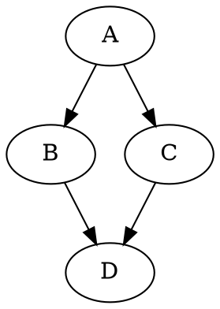

# Визуализатор зависимостей npm

Учебная программа на Python для анализа и визуализации
зависимостей пакетов JavaScript (npm).

Проект разработан поэтапно:

1. YAML-конфигурация и проверка параметров.
2. Получение прямых зависимостей npm-пакетов.
3. Построение графа зависимостей рекурсивным BFS.
4. Поиск обратных зависимостей.
5. Визуализация графа в DOT, SVG и ASCII.

Для получения данных о зависимостях используются стандартные
средства Python. Готовые библиотеки анализа зависимостей
и менеджеры пакетов для этой задачи не применяются.

## Структура проекта

```text
package-graph/
├── src/
│   ├── main.py
│   └── visualize.py
├── tests/
│   ├── test_config.py
│   ├── test_npm.py
│   ├── test_graph.py
│   ├── test_reverse.py
│   ├── test_visualize.py
│   └── repository*.json
├── config.yaml
├── config-test.yaml
├── config-test-depth.yaml
├── config-test-diamond.yaml
├── config-test-empty.yaml
├── config-reverse-chain.yaml
├── config-reverse-diamond.yaml
├── config-reverse-depth.yaml
├── config-viz-chalk.yaml
├── config-viz-ansi.yaml
├── config-viz-supports.yaml
├── requirements.txt
├── run.bat
├── .gitignore
└── README.md
```

Основные файлы:

- `src/main.py` – обработка настроек, запросы к npm и обход BFS.
- `src/visualize.py` – создание DOT, SVG и ASCII-дерева.
- `config.yaml` – конфигурация основного npm-пакета.
- `config-test*.yaml` – проверка тестовых графов.
- `config-reverse*.yaml` – проверка обратных зависимостей.
- `config-viz*.yaml` – примеры визуализации трех пакетов.
- `tests/` – тестовые репозитории и автоматические тесты.
- `run.bat` – запуск программы в Windows.

## Конфигурация YAML

Пользовательские настройки хранятся в YAML-файле.

Пример `config.yaml`:

```yaml
package: "chalk"
repository: "https://registry.npmjs.org"
test_mode: false
version: "4.1.2"
output_file: "graph.svg"
ascii_tree: true
max_depth: 3
```

Описание параметров:

| Параметр | Назначение |
| --- | --- |
| `package` | Имя анализируемого пакета |
| `repository` | URL npm или путь к тестовому JSON |
| `test_mode` | Использование тестового репозитория |
| `version` | Точная версия исходного пакета |
| `output_file` | Имя выходного SVG-файла |
| `ascii_tree` | Включение ASCII-дерева |
| `max_depth` | Максимальная глубина обхода |

Программа проверяет типы и значения всех параметров.

При ошибке настройки выводится сообщение с ее описанием.

## Установка

Необходим Python 3.9 или новее.

Установка Python-зависимостей:

```powershell
py -m pip install -r requirements.txt
```

Для чтения YAML используется библиотека PyYAML.
Она не применяется для получения зависимостей npm.

Для создания SVG необходимо установить Graphviz:

```powershell
winget install -e --id Graphviz.Graphviz
```

После установки следует перезапустить терминал VS Code.

Проверка Graphviz:

```powershell
dot -V
```

Команда должна показать установленную версию Graphviz.

## Запуск программы

Основной запуск:

```powershell
py src/main.py --config config.yaml
```

Запуск через `run.bat`:

```powershell
.\run.bat --config config.yaml
```

Просмотр параметров командной строки:

```powershell
py src/main.py --help
```

## Этап 1. YAML-конфигурация

На первом этапе реализованы:

- чтение параметров из YAML;
- проверка имени пакета;
- проверка URL или пути к файлу;
- проверка режима тестирования;
- проверка версии;
- проверка имени SVG-файла;
- проверка режима ASCII-дерева;
- проверка максимальной глубины.

Настройки отделены от программного кода.

## Этап 2. Получение прямых зависимостей

Программа обращается к npm Registry API и получает
метаданные указанной версии пакета.

Для получения данных используется `urllib.request`.

Пример запроса:

```text
https://registry.npmjs.org/chalk/4.1.2
```

Из ответа JSON извлекается поле `dependencies`.

Запуск режима прямых зависимостей:

```powershell
py src/main.py --config config.yaml --direct
```

Пример вывода:

```text
Прямые зависимости chalk@4.1.2:
ansi-styles: ^4.1.0
supports-color: ^7.1.0
```

Программа обрабатывает ошибки подключения, отсутствия
пакета и некорректного ответа сервера.

## Этап 3. Построение графа зависимостей

Для построения графа используется BFS
(Breadth-First Search) – обход в ширину.

Функция `bfs_recursive()` сначала обрабатывает все пакеты
текущего уровня, затем рекурсивно переходит к следующему.

Граф хранится в словаре:

```python
{
    "A": ["B", "C"],
    "B": ["D"],
    "C": ["D"],
    "D": ["A"]
}
```

Множество `visited` предотвращает повторный обход
уже посещенных вершин.

При этом связи, образующие цикл, сохраняются.

Параметр `max_depth` ограничивает глубину:

- `0` – только исходный пакет;
- `1` – прямые зависимости;
- `2` – зависимости двух уровней;
- `3` – зависимости трех уровней.

Запуск тестового графа:

```powershell
py src/main.py --config config-test.yaml
```

Другие проверки:

```powershell
py src/main.py --config config-test-depth.yaml
py src/main.py --config config-test-diamond.yaml
py src/main.py --config config-test-empty.yaml
```

Тестовые пакеты называются заглавными латинскими буквами:
`A`, `B`, `C`, `D` и так далее.

Для реальных npm-пакетов программа использует точную версию
исходного пакета и упрощенный выбор версий его зависимостей.

Поддержаны точные версии, `^`, `~`, `*`, операторы
сравнения и альтернативы `||`.

Полная совместимость с npm SemVer не реализована.

## Этап 4. Обратные зависимости

Обратные зависимости – пакеты, которые зависят
от заданного пакета.

Например:

```text
A -> B -> C -> D
```

Если выбрать пакет `D`, обратный обход найдет:

```text
D <- C
C <- B
B <- A
```

Для поиска используется тот же рекурсивный BFS.

Перед обходом программа меняет направление связей
в тестовом репозитории.

Запуск:

```powershell
py src/main.py --config config-reverse-chain.yaml --reverse
```

Другие примеры:

```powershell
py src/main.py --config config-reverse-diamond.yaml --reverse
py src/main.py --config config-reverse-depth.yaml --reverse
py src/main.py --config config-test.yaml --reverse
py src/main.py --config config-test-empty.yaml --reverse
```

Режим `--reverse` работает с локальным тестовым
репозиторием, для которого известны все связи.

Глобальные обратные зависимости npm не поддерживаются,
так как метаданные одного пакета не содержат полного
списка всех пакетов, которые его используют.

## Этап 5. Визуализация

Реализованы три способа представления графа:

1. Текстовое описание Graphviz DOT.
2. Графическое изображение SVG.
3. ASCII-дерево в терминале.

Для включения визуализации используется `--visualize`.

Пример:

```powershell
py src/main.py --config config-test.yaml --visualize
```

Программа создает файлы:

```text
test_graph.dot
test_graph.svg
```

Файл DOT содержит описание вершин и направленных ребер.

Пример:



Программа передает DOT-файл установленной программе
Graphviz `dot` и получает SVG-изображение.

SVG можно открыть в браузере или VS Code.

Если `ascii_tree: true`, дополнительно выводится дерево:

```text
A
|-- B
|   `-- D
|       `-- A (цикл)
`-- C
    `-- D (повтор)
```

Пометка `(цикл)` означает возврат к вершине,
которая уже находится в текущей ветви.

Пометка `(повтор)` означает, что пакет встречался ранее.

Если достигнут предел глубины, появляется
пометка `(предел глубины)`.

### Визуализация обратных зависимостей

```powershell
py src/main.py --config config-reverse-chain.yaml --reverse --visualize
```

В результате создаются файлы:

```text
reverse_chain.dot
reverse_chain.svg
```

Флаги `--direct` и `--reverse` нельзя включать одновременно.
Режим `--direct` также несовместим с `--visualize`.

## Примеры визуализации трех npm-пакетов

Для выполнения задания выбраны три пакета.

### 1. chalk версии 4.1.2

```powershell
py src/main.py --config config-viz-chalk.yaml --visualize
```

Файл изображения:

```text
chalk.svg
```

Прямые зависимости:

- `ansi-styles`
- `supports-color`

### 2. ansi-styles версии 4.3.0

```powershell
py src/main.py --config config-viz-ansi.yaml --visualize
```

Файл изображения:

```text
ansi-styles.svg
```

Прямая зависимость:

- `color-convert`

### 3. supports-color версии 7.2.0

```powershell
py src/main.py --config config-viz-supports.yaml --visualize
```

Файл изображения:

```text
supports-color.svg
```

Прямая зависимость:

- `has-flag`

Для этих трех запусков необходим интернет.

## Сравнение со штатным инструментом npm

Для проверки результатов используется команда:

```powershell
npm ls --all --depth=3
```

В отличие от нашей программы, npm показывает дерево
фактически установленных зависимостей.

Для корректного сравнения пакеты следует устанавливать
в отдельных временных каталогах.

Пример для `chalk@4.1.2`:

```powershell
mkdir "$env:TEMP\npm-check-chalk" -Force
cd "$env:TEMP\npm-check-chalk"
npm init -y
npm install --save-exact --ignore-scripts chalk@4.1.2
npm ls --all --depth=3
```

Аналогично можно проверить:

```powershell
npm install --save-exact --ignore-scripts ansi-styles@4.3.0
npm ls --all --depth=3
```

И:

```powershell
npm install --save-exact --ignore-scripts supports-color@7.2.0
npm ls --all --depth=3
```

Для независимого сравнения каждого пакета нужно
использовать отдельный каталог.

### Что сравниваем

- Имена прямых зависимостей.
- Версии найденных пакетов.
- Транзитивные зависимости.
- Глубину обхода.
- Повторяющиеся зависимости.

### Причины возможных расхождений

1. Программа самостоятельно выбирает наибольшую стабильную
   версию, подходящую под поддерживаемый диапазон SemVer.

2. npm учитывает условия установки пакетов и файл
   `package-lock.json`.

3. npm дополнительно обрабатывает другие типы зависимостей,
   включая `peerDependencies` и `optionalDependencies`.

4. Наша программа хранит общие пакеты в графе один раз,
   тогда как npm показывает дерево установленных зависимостей.

5. Реализация SemVer в учебном проекте упрощена.

6. Результат программы ограничивается параметром
   `max_depth`.

Поэтому совпадение имен прямых зависимостей ожидается,
но полное совпадение деревьев не гарантируется.

Окончательные результаты сравнения определяются
после запуска обеих программ на одинаковых пакетах.

## Автоматические тесты

Для проверки используется стандартный модуль Python
`unittest`.

Запуск всех тестов:

```powershell
py -m unittest discover -s tests -v
```

Проверяются:

- корректность YAML;
- обработка ошибочных настроек;
- получение прямых npm-зависимостей;
- ошибки HTTP и JSON;
- рекурсивный BFS;
- циклические зависимости;
- максимальная глубина;
- тестовые репозитории;
- обратные зависимости;
- преобразование графа в DOT;
- создание SVG;
- вывод ASCII-дерева;
- совместимость предыдущих этапов.

Тесты HTTP используют имитацию ответов сервера.

Тест реального преобразования SVG пропускается,
если Graphviz не установлен.

## Ограничения программы

- Реальные npm-зависимости требуют подключения к интернету.
- Поддержка SemVer является упрощенной.
- Полный алгоритм установки npm не воспроизводится.
- Обратные зависимости доступны в тестовом режиме.
- Для SVG требуется установленная программа Graphviz.
- Граф ограничивается глубиной, указанной в YAML.

## Git и оформление репозитория

Работа сохраняется по этапам отдельными коммитами:

```text
feat(config): add YAML configuration
feat(npm): fetch direct dependencies
feat(graph): build dependency graph
feat(graph): add reverse dependencies
feat(viz): add graph visualization
```

Сообщения соответствуют формату Conventional/Scoped Commits.

Исходный код находится в `src`, тесты – в `tests`.

Файл `.gitignore` исключает кеш Python, настройки
редактора и генерируемые файлы `.dot` и `.svg`.

Автоматически созданные изображения не включаются
в Git-репозиторий.
